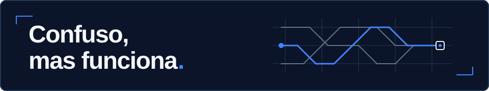

# Caio Bertolato Silva

**Engenharia de Computação · Desenvolvimento Web · Automações · Experiências Digitais**

Gosto de problemas que me fazem pensar. Questionar uma solução, testar caminhos e transformar uma ideia em algo que funciona é a parte do desenvolvimento que mais me interessa.

Estudo **Engenharia de Computação no CEFET-MG** e trabalho com desenvolvimento de lojas e experiências digitais em **Shopify, Liquid, HTML, CSS e JavaScript**. Também exploro aplicações com React e Next.js, automações, integrações com IA e jogos em Godot.

Minha curiosidade costuma abrir várias possibilidades. O que dá forma a elas é prototipar, validar e refinar.

## Projetos selecionados

### 01 · Plataforma de Sócios do Fórmula Cefast

Do processo manual à gestão de associados: uma plataforma de assinaturas construída com Next.js, React, TypeScript, Tailwind CSS e Stripe.

### 02 · Cheat Code

Uma experiência de e-commerce em Shopify com identidade inspirada em HUDs. O trabalho reúne componentes personalizáveis, Liquid e prototipação de interfaces para dar forma à identidade da loja.

### 03 · Forgets

Um projeto de automação para explorar possíveis oportunidades comerciais esquecidas em conversas. Combina n8n, WhatsApp, PostgreSQL, Redis e IA na investigação desse problema.

### 04 · Trilha Federal

Projeto acadêmico de desenvolvimento web para facilitar o acesso a informações sobre instituições públicas, vestibulares e caminhos de ingresso no ensino superior.

[Explorar o Trilha Federal](https://trilhafederal.vercel.app/)

### 05 · Runner Survivor

O jogo que eu gostaria de jogar: corrida contínua, combate e progressão com mecânicas survivor. Desenvolvido em Godot, com GDScript.

> Parte desses projetos é profissional, privada ou está em desenvolvimento. Os links disponíveis aparecem junto de cada projeto.

## Código para explorar

[Hospital · sistema de consultas em C](https://github.com/CaiouBS/Hospital) — aplicação de terminal com listas encadeadas para organizar médicos, pacientes e consultas.

## Ferramentas que uso

- **Web e interfaces:** JavaScript, TypeScript, React, Next.js, HTML, CSS, Tailwind CSS, Shopify e Liquid.
- **Automações e integrações:** n8n, PostgreSQL, Redis, APIs e Stripe.
- **Outras experiências:** C, Godot e Git.

## Como eu trabalho

**Ideia → Questionamento → Protótipo → Testes → Implementação → Refinamento.**

Uso IA para explorar possibilidades, analisar soluções e apoiar o desenvolvimento. Entender o problema e decidir o que faz sentido construir continuam sendo parte central do meu trabalho.

## Contato

[GitHub · @CaiouBS](https://github.com/CaiouBS)

---

*Às vezes funciona de primeira. A graça costuma estar quando não funciona.*
